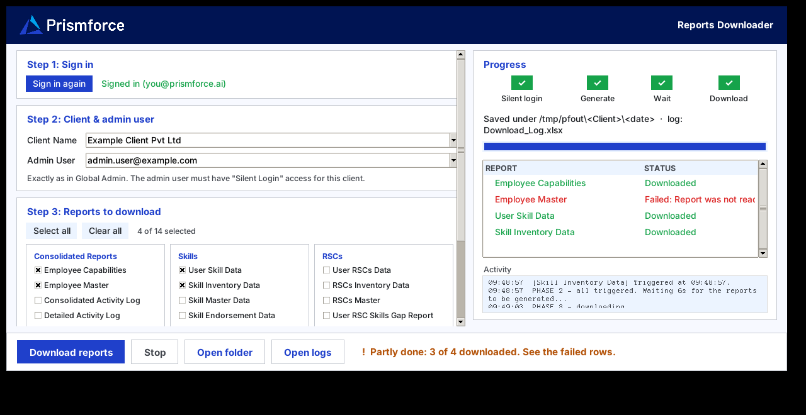
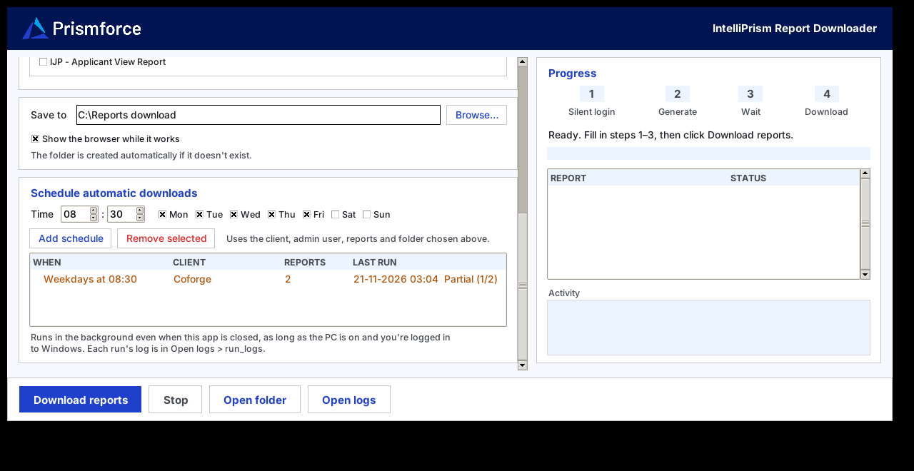
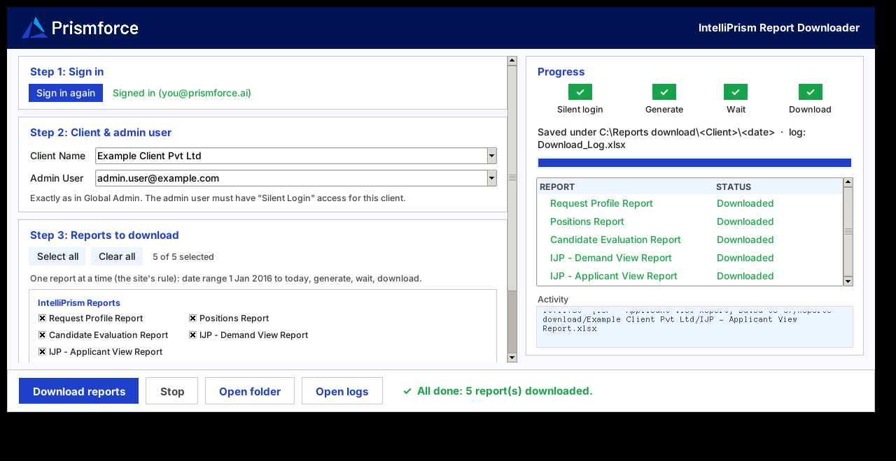

# Prismforce Report Downloaders

Two branded desktop apps that download reports for any client in a few clicks: sign in, pick the client and admin user, tick the reports, click **Download reports**.

| App | What it downloads | Download |
|---|---|---|
| **SkillPrism Report Downloader** | SkillPrism Reports Center: 14 reports in 5 categories | **[SkillPrism_Report_Downloader.exe](../../releases/latest/download/SkillPrism_Report_Downloader.exe)** |
| **IntelliPrism Report Downloader** | IntelliPrism reports: Request Profile, Positions, Candidate Evaluation, IJP Demand View, IJP Applicant View | **[IntelliPrism_Report_Downloader.exe](../../releases/latest/download/IntelliPrism_Report_Downloader.exe)** |

Windows, nothing to install.



---

## How to use (both apps)
1. **Open** the `.exe`.
   - Chrome says *"isn't commonly downloaded"*: click **⋯ → Keep → Keep anyway**.
   - Windows says *"protected your PC"*: click **More info → Run anyway**. The apps are unsigned.
2. **Step 1: Sign in** (first time only). Edge opens and clicks *Sign in with Google*. Pick your @prismforce.ai account and finish 2FA if asked. Both apps share this sign-in.
3. **Step 2: Client & admin user**, exactly as in **Global Admin → Clients** and that client's **Users**. The admin user needs **Silent Login** access. Recent clients are remembered.
4. **Step 3: Reports.** Tick them, or **Select all**.
5. Click **Download reports** and watch the live progress. **Stop** cancels between steps.

Files go to `C:\Reports download\<Client>\<DD-MM-YYYY>\<Report>_<HHMMSS>.xlsx`. Change this with **Save to**. Every attempt is logged in `Download_Log.xlsx` in that folder.
The folder, including any missing parent folders, is **created automatically** if it doesn't exist.

## Schedule automatic downloads


1. Fill in Steps 2–3 and **Save to**, as for a normal run.
2. In **Schedule automatic downloads**, pick a **time** and **days** (default: weekdays 08:30).
3. Click **Add schedule**.

That's it. Each schedule:
- runs through **Windows Task Scheduler**, so it works **even when the app is closed**, as long as the PC is on and you're logged in to Windows
- runs in the background with no window, reusing your saved sign-in
- shows its **last result** in the app (Success, Partly done or Failed, plus the reason)
- writes a log to `run_logs\scheduled_<date>.log` (via **Open logs**)

You can add several schedules (e.g. one per client), and remove any with **Remove selected**. If your sign-in has expired when a schedule runs, its result says so. Open the app and click **Sign in again**.

## How each app works

### SkillPrism Report Downloader
Global Admin → client → **Silent Login** → Reports Center
1. **Trigger** *Generate Report* for every selected report.
2. **Wait** 2 minutes.
3. **Download** only the Download History rows created by this run.

### IntelliPrism Report Downloader


Global Admin → client → **Silent Login** → Intelliprism Reports, then **one report at a time** (the site builds only one at once):
1. Click the report's **GENERATE REPORT**.
2. Set the required date range to **1 Jan 2016 → today**. All other filters stay blank.
3. **GENERATE REPORT**, which shows "Report is generating".
4. In **Downloads**, wait until **this run's** row (by *Requested on* time) shows **Success**.
5. Click **DOWNLOAD**, save, then move to the next report.

## Good to know
- **Nothing to set up:** no Setup.bat, no config.json, no command prompt. Your email is picked up from the sign-in.
- **Passwords are never entered or stored by the apps.** Google sign-in happens in the browser window.
- **Run one app at a time.** Both use the same signed-in browser.
- **Open logs** (bottom bar) opens `%APPDATA%\PF Reports Downloader\`:
  - `run_logs\`: every run
  - `debug\`: page snapshots whenever a step fails. Send these when reporting a problem.
- **Optional email summaries:** add `"gmail_app_password": "<16 chars>"` to `%APPDATA%\PF Reports Downloader\config.json`.

## Files
| File | What it is |
|---|---|
| `app_gui.py` | The branded desktop window (shared by both apps) |
| `app_skillprism.py`, `app_intelliprism.py` | Entry points for the two `.exe`s |
| `automation.py` | Sign-in, Silent Login and the SkillPrism engine |
| `rms_automation.py` | IntelliPrism engine: dates, generate, wait, download |
| `scheduling.py` | Scheduled downloads: Windows Task Scheduler + background run mode (`--scheduled <id>`) |
| `config.py`, `report_log.py` | Settings and the Excel run log |
| `tests/mock_rms.py` | A mock of the IntelliPrism pages for testing without the real site |
| `branding/` | Official Prismforce logo and icon |
| `.github/workflows/build.yml` | Builds both `.exe`s on Windows, self-tests them, publishes the release |

### Run from source
```bash
pip install -r requirements.txt
python app_skillprism.py      # or: python app_intelliprism.py
```

### Releasing a new version
Push to `main`. GitHub builds both apps on Windows, self-tests each (window, engine, browser driver, a real Task Scheduler task, background mode), and only then publishes them to **[Releases → latest](../../releases/latest)**. The download links above always serve the newest build.
